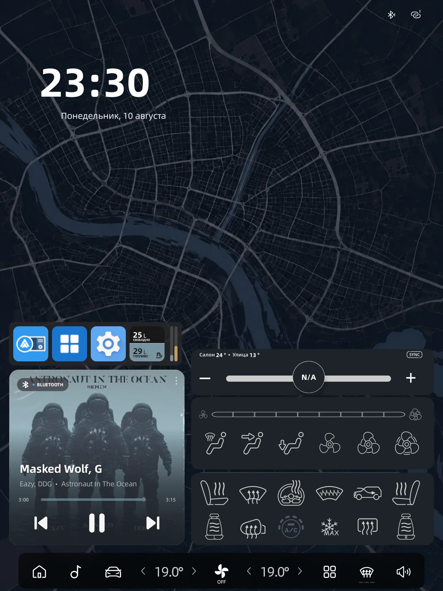
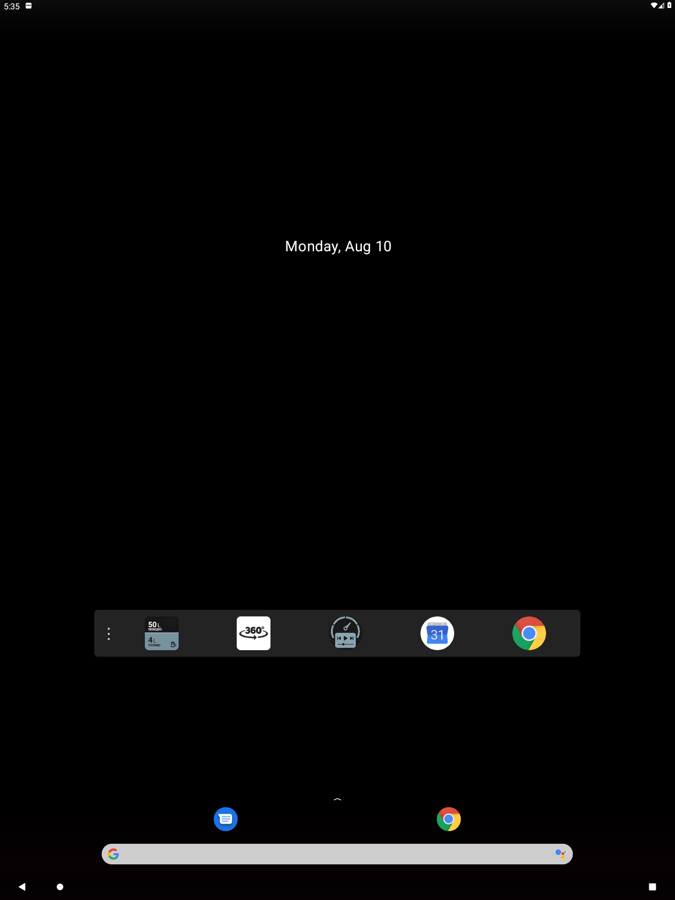
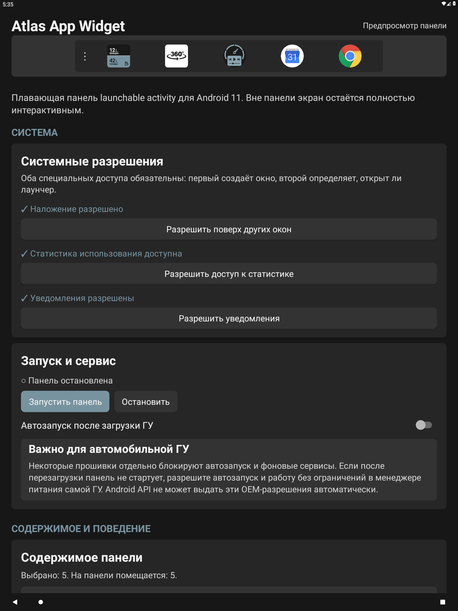
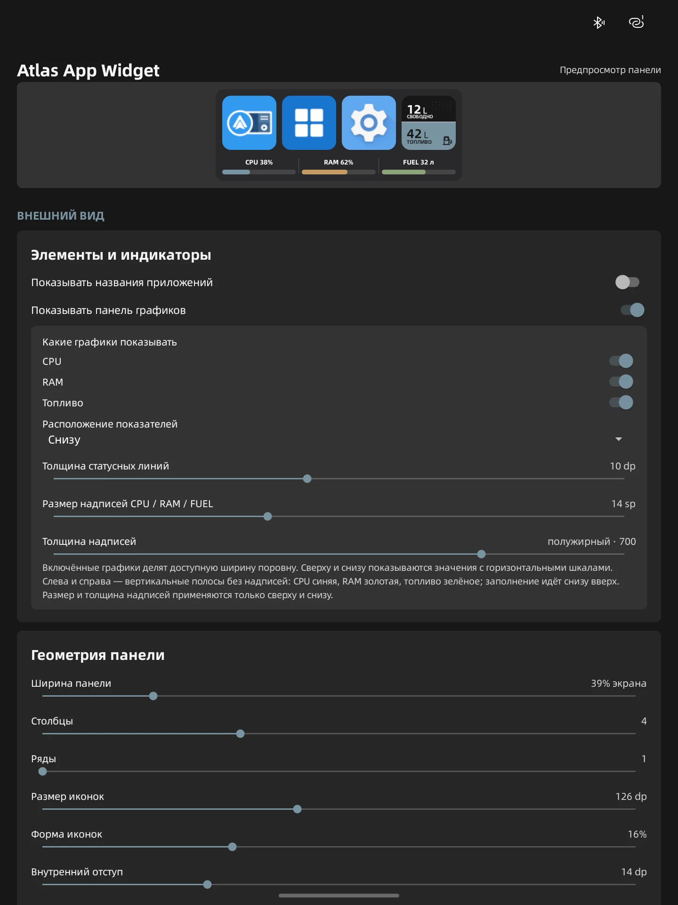
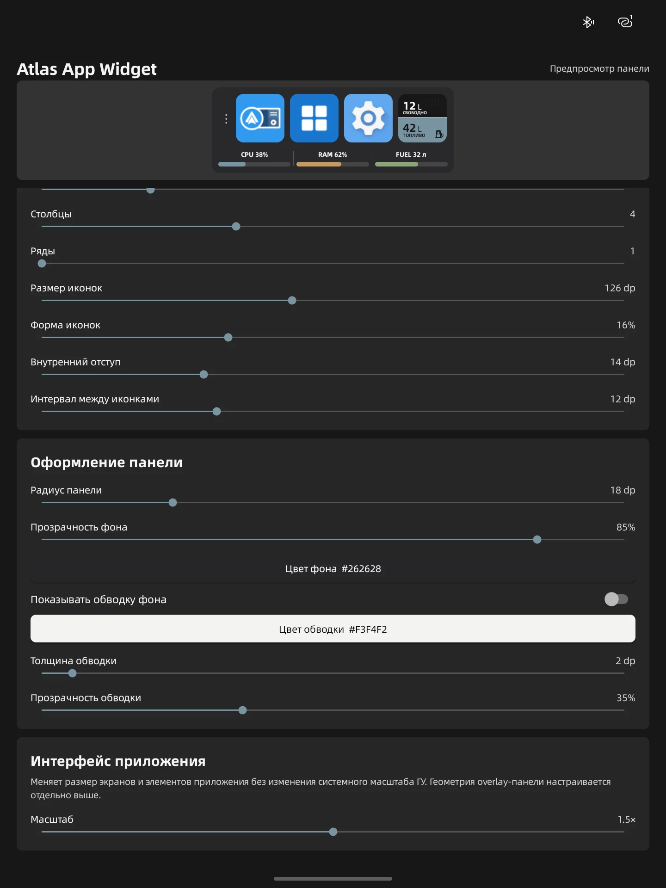

<p align="center">
  
</p>

<h1 align="center">Atlas App Widget</h1>

<p align="center">
  Настраиваемая панель ярлыков для портретных автомобильных ГУ на Android 11
</p>

Atlas App Widget размещает поверх домашнего экрана панель с выбранными приложениями и activity.
Панель появляется только поверх HOME/лаунчера, а остальная часть экрана остаётся интерактивной.

Доступны два режима: оверлей через `TYPE_APPLICATION_OVERLAY` и системный Android-виджет.
Режим переключается на вкладке «Панель». Подробности — в разделе
[Режимы и настройка](#режимы-и-настройка).

## Интерфейс

Панель занимает только выбранную область домашнего экрана: ярлыки остаются доступны поверх HOME,
не перекрывая управление остальными элементами лаунчера.

<p align="center">
  <a href="docs/images/home-overview.webp">
    
  </a>
</p>

<p align="center"><strong>Панель крупным планом</strong></p>

<p align="center">
  <a href="docs/images/overlay-home.webp">
    
  </a>
</p>

Настройки показывают результат в живом предпросмотре. Отдельно регулируются содержимое панели,
системные индикаторы, геометрия и оформление.

<table>
  <tr>
    <th>Запуск и содержимое</th>
    <th>Индикаторы и геометрия</th>
    <th>Оформление панели</th>
  </tr>
  <tr>
    <td>
      <a href="docs/images/settings-overview.webp">
        
      </a>
    </td>
    <td>
      <a href="docs/images/settings-indicators.webp">
        
      </a>
    </td>
    <td>
      <a href="docs/images/settings-appearance.webp">
        
      </a>
    </td>
  </tr>
</table>

## Возможности

- выбор экспортируемых `MAIN`/`LAUNCHER` activity и ручная настройка их порядка;
- импорт собственной картинки для каждого ярлыка и возврат к системной иконке;
- сетка до 10 столбцов и 4 рядов, регулируемые размер, форма и интервалы иконок;
- опциональные однострочные названия приложений;
- настройка ширины, цвета, прозрачности и радиуса панели, а также внешней обводки;
- живой предпросмотр панели на экране настроек;
- графики CPU, RAM и топлива сверху, снизу, слева или справа от ярлыков;
- отдельная живая плитка топлива с экраном подробных данных;
- перетаскивание за ручку с любой стороны панели;
- перемещение после удержания пустого места в течение одной секунды, если ручка скрыта;
- независимый масштаб интерфейса настроек от 1× до 2× без изменения системного масштаба ГУ;
- автозапуск после обычной и Direct Boot-загрузки, включая автомобильный `QUICKBOOT_POWERON`;
- импорт и экспорт переносимых настроек в версионированный JSON;
- сохранение выбранных activity, собственных иконок, положения и оформления при обычном обновлении.

## Требования

- Android 11 или новее (`minSdk 30`);
- портретный экран; целевая конфигурация — 1440×1920;
- разрешение «Поверх других приложений» для окна панели;
- «Доступ к статистике использования» для определения активного HOME/лаунчера.

GInputBridge не нужен для ярлыков, CPU или RAM. Он требуется только для живой плитки и графика
топлива. На совместимой ГУ в GInputBridge должен быть включён Runtime внешнего API.

## Установка и запуск

1. Установите подписанный APK Atlas App Widget и откройте приложение.
2. На вкладке «Панель» выберите режим: «Оверлей» или «Виджет».
3. Для оверлея выдайте в карточке «Оверлей» разрешения поверх окон, на статистику
   использования и контроль окон, затем нажмите `Запустить панель`. При необходимости
   включите автозапуск после загрузки ГУ.
4. Для виджета нажмите «Добавить виджет на рабочий стол» или добавьте Atlas App Widget через
   меню виджетов лаунчера.
5. На вкладке «Ярлыки» выберите приложения, activity или плитку топлива, на вкладке «Вид»
   настройте сетку и оформление по предпросмотру.

Для установки через ADB:

```sh
adb install AtlasAppWidget.apk
```

Если прошивка имеет собственный менеджер автозапуска или энергосбережения, отдельно разрешите в
нём запуск приложения и фоновую работу. Android API не может выдать эти OEM-разрешения.

## Режимы и настройка

Экран настроек разделён на вкладки; заголовок, вкладки и предпросмотр закреплены сверху:

- **Панель** — режим отображения. В режиме виджета — число размещённых виджетов и кнопка
  добавления; в режиме оверлея — разрешения, запуск и автозапуск, перемещение и видимость;
- **Ярлыки** — выбор приложений, подписи под иконками, скрытие климата, плитка и формула
  топлива;
- **Вид** — стиль OneOS, сетка, размер панели (только оверлей), фон и обводка, системный статус
  CPU/RAM/топлива (только оверлей);
- **Система** — уведомления, импорт и экспорт настроек, масштаб интерфейса.

Предпросмотр показывается на вкладках «Ярлыки» и «Вид». Тонкие параметры (размер подписей,
отступы, обводка, линии и шрифт статуса, формула топлива, длительность скрытия климата)
свёрнуты; раскрываются нажатием на заголовок со стрелкой. Блоки другого режима скрыты.

В режиме виджета HOME управляет размером и положением, а строки, столбцы, выбранные ярлыки,
иконки, подписи, отступы и фон берутся из общих настроек. При уменьшении области сетка
сохраняется, иконки уменьшаются пропорционально. Ручка перемещения, правила видимости и графики
CPU/RAM относятся только к оверлею. Разрешения наложения, статистики и контроля окон виджету не
нужны. Нажатие на плитку топлива в виджете открывает небольшое окно поверх рабочего стола на
10 секунд; оно закрывается кнопкой «Закрыть», нажатием снаружи или кнопкой «Назад». Для живых
обновлений плитки работает сервис с уведомлением, пока плитка размещена.

При добавлении виджета через меню лаунчера поверх HOME открывается короткий мастер
(`WidgetSetupActivity`) с настоящим предпросмотром в размере, который сообщил лаунчер:

- число выбранных приложений и кнопка «Выбрать приложения»;
- столбцы (1–10), ряды (1–4) и подписи под иконками;
- если выбран оверлей — переключатель «Переключить в режим Android-виджета» (включён по
  умолчанию и применяется только при подтверждении; без него виджет покажет «Включите режим
  Android-виджета…»);
- «Добавить» размещает виджет, «Добавить и открыть все настройки» дополнительно открывает
  приложение.

Настройки общие для всех виджетов и оверлея. Столбцы, ряды и подписи применяются сразу ради
честного предпросмотра; отмена («✕», «Назад», нажатие снаружи) возвращает их прежние значения и
отменяет размещение. Изменения списка приложений при отмене не откатываются: у него свой
редактор. Повторная настройка уже размещённого виджета (например, кнопкой ⚙ в режиме
редактирования AtlasLauncher) открывает тот же мастер с кнопками «Готово» и «Открыть все
настройки». Нажатие на пустой виджет открывает приложение.

## Использование

- нажатие на ярлык запускает выбранную activity;
- панель скрывается при переходе из HOME в другое приложение;
- для перемещения используйте ручку или удерживайте пустое место панели одну секунду, если ручка
  отключена;
- нажатие на плитку топлива открывает уровень, запас хода, расчёт литров и время последнего ответа;
- кнопка сброса положения возвращает панель в безопасную область экрана.

## Данные топлива

Плитка и график топлива читают датчик Fuel Percentage из GInputBridge. Стандартная формула —
`литры = значение API × 0.5 + 4`; API передаёт значение от 0 до 100, поэтому максимальный объём
бака вычисляется по формуле и равен 54 л. В настройках можно задать собственные множитель и
смещение — объём бака также пересчитывается по этой формуле. При API=0 интерфейс показывает
оценочные границы: `<4` залитого и `>50` свободного топлива для стандартной формулы. Если
GInputBridge не отвечает или данные устарели, интерфейс показывает недоступное значение, а не
сохраняет его бессрочно.

## Перенос настроек

На главном экране в разделе «Система» можно экспортировать конфигурацию в JSON и импортировать её
на этой или другой ГУ. Файл содержит выбранные activity и их порядок, положение overlay, геометрию
и оформление панели, системные индикаторы, формулу топлива, масштаб интерфейса и автозапуск.
Системные разрешения, текущее состояние сервиса и файлы пользовательских иконок в резервную копию
не входят. Импорт не удаляет пользовательские иконки, уже сохранённые на целевой ГУ. Если в
прошивке нет системного выбора файлов, экспорт автоматически сохраняет JSON в папку `Download`.

## Сборка

Требуются JDK 17 и Android SDK 36. Сборка выполняется репозиторным Gradle Wrapper:

```sh
ANDROID_HOME=/path/to/android-sdk sh gradlew --offline clean check assembleRelease
```

Release APK создаётся в `app/build/outputs/apk/release/` с именем вида
`<versionName>[<versionCode>]AtlasAppWidget-release.apk`. Без подключённой локальной release-подписи
имя заканчивается на `-unsigned.apk`.

Для debug-сборки:

```sh
ANDROID_HOME=/path/to/android-sdk sh gradlew --offline assembleDebug
```

Локальная release-подпись подключается через игнорируемый файл `secure.signing.gradle`; пример
находится в [`app/secure.signing.gradle.example`](app/secure.signing.gradle.example). Keystore и
секреты не должны попадать в Git. Application ID проекта — `com.mmwtl.atlasappwidget`.

## Совместимость и ограничения

- основной проверенный сценарий — портретная ГУ на Android 11; поведение других прошивок требует
  проверки на реальном устройстве;
- в список попадают только доступные стороннему приложению `MAIN`/`LAUNCHER` activity;
- область под самой панелью принимает нажатия по ярлыкам и жест перемещения, но окно не блокирует
  остальную часть экрана;
- без Usage Access приложение не может надёжно показывать панель только поверх HOME;
- OEM-прошивка может отдельно ограничить foreground service, автозапуск или работу после загрузки;
- установка обновления поверх APK с другой подписью будет отклонена Android.
